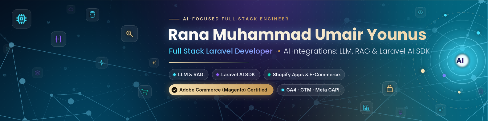

# Rana Muhammad Umair Younus — Portfolio

Personal portfolio of **Rana Muhammad Umair Younus**, Full Stack Lead Laravel Developer focused on AI integrations (LLM, RAG, Laravel AI SDK), Shopify apps and e-commerce. Adobe Commerce (Magento) certified.

**Live site:** https://r-jee.github.io/Portfolio/

## What's here

| File | Purpose |
| --- | --- |
| `index.html` | The whole site: one self-contained page (styles, script and photo embedded) |
| `assets/og-banner.png` | Social preview image used when the link is shared |
| `assets/favicon.png` | Browser tab icon |
| `assets/profile.png` | Profile photo |
| `.nojekyll` | Tells GitHub Pages to serve the files as-is |

## Run locally

Open `index.html` in a browser. No build step and no dependencies.

## Deploy

Settings → Pages → Source: **Deploy from a branch** → Branch: `main`, folder `/ (root)`.

## Credits

Tech stack icons by [Icons8](https://icons8.com).
